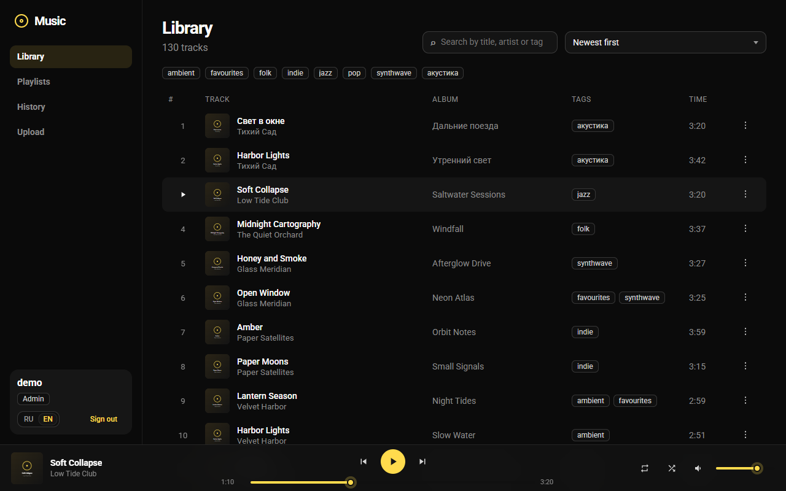
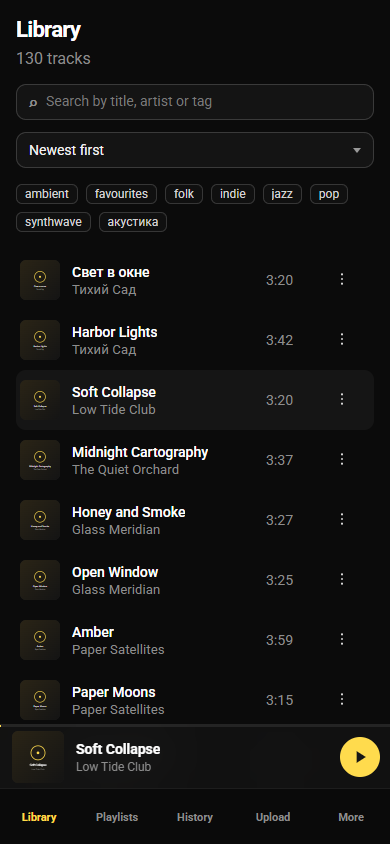

# Cloud Music

<p align="center">
  
  
</p>

**English** · [Русский](README.ru.md)

A local music server: **Vue 3 + TypeScript** on the client, **Bun + TypeScript** on the server, **SQLite** and **JWT**.
The interface speaks English and Russian (a switch in the sidebar and on the sign-in page).

Built with [TaoUI](https://github.com/1337exp/taoui) 5. Repository: [1337exp/cloud-music](https://github.com/1337exp/cloud-music).

```
src/
  client/    Vue app
  server/    Bun HTTP API
  shared/    shared types and constants
  tools/     user creation, indexing, demo data
```

A living list of what it can do and what it cannot yet: [FEATURES.md](FEATURES.md) (in Russian).

## Run

```bash
bun install
bun run user:create admin password admin
bun run dev
```

Client: http://127.0.0.1:5173  
API: http://127.0.0.1:8787

Production (after a build the client is served by Bun itself):

```bash
bun run build
bun run start
```

## Playback

The player plays the **whole collection**, not the page you happen to have open. Click a track in the library and the queue is
every track of that list (same search, tag and sort), so when the last track of page 1 ends, the first of page 2 starts.
Paging the list is up to you; the player never turns pages. Playlists and the history play as they are listed.

- **Next / Previous** always move along the queue, whatever the repeat mode. Previous restarts the track if it is more than 3 seconds in.
- **Repeat**: off (stops at the end of the queue) / all (wraps around) / one (replays a track that ends by itself).
- **Shuffle** plays every track once, in a random order, then reshuffles if repeat is on.
- A file that is missing or broken is skipped; after five failures in a row the player stops.
- Keys: Space plays and pauses, ← / → seek 5 seconds. Headset and OS media keys work through the Media Session API.

## Language

The first visit follows the browser language (Russian if it starts with `ru`, English otherwise); the switch remembers the choice in the browser.
TaoUI's own texts (upload zone, pagination and the like) follow it, and so do the server's error messages: the client sends the language in an `X-Lang` header.
New texts live in `src/client/i18n.ts` (the interface) and `src/server/messages.ts` (API errors); add a language by adding a column to both.

## Accounts

There is no public sign-up. An admin creates users with a script:

```bash
bun run user:create <username> <password> <role>
bun run user:create lazy secret editor --force
```

Roles:

- `listener`: listens, searches, playlists, history
- `editor`: the same plus upload, delete, editing titles and tags
- `admin`: everything an editor can do

## Storage

One SQLite file holds everything: users, playlists, history and the track index. A separate "music database" would buy almost nothing, since playlists and history point at track ids anyway.

Another disk or a network folder is not a second database but one more path in `musicDirs`. The index and the accounts live in `dataDir` (the system disk), the files live wherever you like.

### Adding a music folder

Paths are set in `server.config.json` in the project root.

1. Open the file and add a directory to `musicDirs`. On Windows forward slashes are easier: `E:/Music`, not `E:\Music`.
2. Restart the server (`bun run dev` or `bun run start`): the config is read at start.
3. If the folder already has files, run the indexer:

```bash
bun run reindex
```

An example with a local folder, a second disk and a network share:

```json
{
  "host": "0.0.0.0",
  "port": 8787,
  "dataDir": "./data",
  "database": "music.db",
  "musicDirs": ["./data/music", "E:/Music", "D:/FLAC", "//NAS/music"]
}
```

Uploads from the UI go into the **first** folder of `musicDirs`. If uploads should land in one place while you also listen to a disk, set `uploadDir` separately:

```json
{
  "uploadDir": "./data/music",
  "musicDirs": ["./data/music", "E:/Music"]
}
```

If a share is not mounted the server still starts and just skips that folder.

The database file name is the `database` field (`music.db` inside `dataDir` by default). Give a full path if SQLite should live away from the covers.

Variables from `.env.example` override this file when set. `MUSIC_DIR` in the environment sets **one** root instead of the whole `musicDirs` list.

## Library

Uploading is for editors and admins, in the "Upload" section.

If the database is damaged, the files on disk can be written into SQLite again:

```bash
bun run reindex
bun run reindex --prune
```

`--prune` removes records whose file is gone.

## Phone and PWA

One client for every screen: on a narrow window the sidebar becomes bottom tabs and the player becomes a strip. A tap on the track name opens seek, repeat, shuffle and volume.

After `bun run build` and `bun run start` the site can go on the home screen (Chrome: "Install app", iOS: "Add to Home Screen"). The shell is cached, so the interface opens faster. Tracks are still streamed from the server; there is no offline library.

From a phone, open your computer's address on the home network, for example `http://192.168.0.183:8787` (production) or `:5173` under `bun run dev`.

## Demo data and screenshots

A throwaway library with made-up tracks, playlists and a history, for trying the player or taking screenshots. Both variables are required so the real library is never touched:

```bash
DATA_DIR=./demo/data MUSIC_DIR=./demo/music bun run demo
```

The script prints the demo login and a random password. To start the server on it, run it with the same two variables.

`bun run screenshot` does all of that on its own in a temporary folder and writes `docs/media/{library,playlist,mobile}-{en,ru}.png`.
It needs Bun and Chrome or Edge (driven through `playwright-core`, nothing is downloaded).

## More

- Search by title, artist, album and tags
- Tags (genre and any labels) and filtering by them
- Up to 100 playlists per user, drag to reorder
- History: the last 50 tracks; the same id twice in a row is not recorded

Environment variables are in `.env.example`, the main config is `server.config.json`. The JWT secret is written to `data/.jwt-secret` on first start unless `JWT_SECRET` is set.
