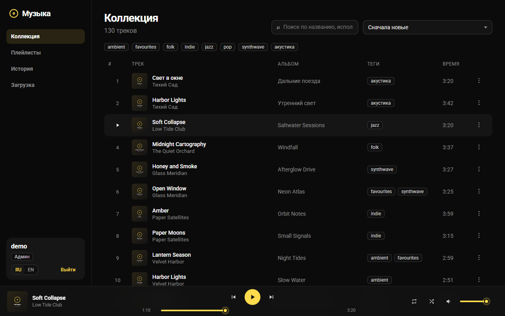
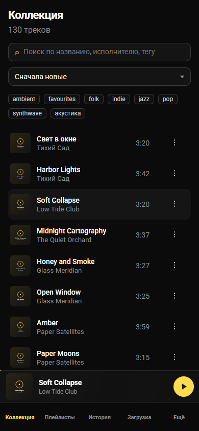

# Облако Музыки

<p align="center">
  
  
</p>

[English](README.md) · **Русский**

Локальный музыкальный сервер: **Vue 3 + TypeScript** на клиенте, **Bun + TypeScript** на сервере, **SQLite** и **JWT**.
Интерфейс на русском и английском (переключатель в сайдбаре и на экране входа).

Интерфейс собран на [TaoUI](https://github.com/1337exp/taoui) 5. Репозиторий проекта: [1337exp/cloud-music](https://github.com/1337exp/cloud-music).

```
src/
  client/    Vue-приложение
  server/    Bun HTTP API
  shared/    общие типы и константы
  tools/     создание пользователя, индексация, демо-данные
```

Живой список «что уже умеет / чего ещё нет» — в [FEATURES.md](FEATURES.md).

## Запуск

```bash
bun install
bun run user:create admin password admin
bun run dev
```

Клиент: http://127.0.0.1:5173  
API: http://127.0.0.1:8787

Прод (после сборки клиент отдаёт сам Bun):

```bash
bun run build
bun run start
```

## Воспроизведение

Плеер играет **всю коллекцию**, а не ту страницу, что сейчас открыта. Нажали трек в коллекции — очередью становятся
все треки этого списка (с тем же поиском, тегом и сортировкой), поэтому после последнего трека первой страницы
сам включается первый трек второй. Листать страницы — дело пользователя, плеер их не переключает.
Плейлисты и история играют в том порядке, в каком показаны.

- **Вперёд / назад** всегда двигаются по очереди, какой бы ни был повтор. «Назад» перезапускает трек, если он играет дольше 3 секунд.
- **Повтор**: выкл (останавливается в конце очереди) / всё (по кругу) / один (повторяет трек, который доиграл сам).
- **Перемешивание** проигрывает каждый трек один раз в случайном порядке; при повторе всего перемешивает заново.
- Пропавший или битый файл пропускается; после пяти подряд плеер останавливается.
- Клавиши: пробел — играть/пауза, ← / → — перемотка на 5 секунд. Клавиши наушников и ОС работают через Media Session.

## Язык

При первом заходе берётся язык браузера (русский, если он начинается с `ru`, иначе английский); выбор переключателем запоминается в браузере.
Вместе с ним переключаются встроенные тексты TaoUI (зона загрузки, пагинация и т. п.) и сообщения об ошибках сервера: клиент передаёт язык заголовком `X-Lang`.
Тексты интерфейса — в `src/client/i18n.ts`, ошибки API — в `src/server/messages.ts`; чтобы добавить язык, допишите колонку в оба файла.

## Аккаунты

Публичной регистрации нет. Пользователя создаёт админ скриптом:

```bash
bun run user:create <логин> <пароль> <роль>
bun run user:create lazy secret editor --force
```

Роли:

- `listener` — слушает, ищет, плейлисты, история
- `editor` — то же + загрузка, удаление, правки названий и тегов
- `admin` — все права редактора

## Хранение

Одна SQLite на всё: пользователи, плейлисты, история и индекс треков. Отдельная «база музыки» почти ничего не даёт — плейлисты и история всё равно ссылаются на id трека.

Другой диск или сетевая папка — это не вторая БД, а ещё один путь в `musicDirs`. Индекс и аккаунты живут в `dataDir` (системный диск), файлы — где удобно.

### Как добавить папку с музыкой

Пути задаются в `server.config.json` в корне проекта.

1. Откройте файл и допишите каталог в `musicDirs`. На Windows удобнее прямые слэши: `E:/Music`, не `E:\Music`.
2. Перезапустите сервер (`bun run dev` или `bun run start`) — конфиг читается при старте.
3. Если в папке уже лежат файлы, прогоните индекс:

```bash
bun run reindex
```

Пример с локальной папкой, вторым диском и сетевой шарой:

```json
{
  "host": "0.0.0.0",
  "port": 8787,
  "dataDir": "./data",
  "database": "music.db",
  "musicDirs": ["./data/music", "E:/Music", "D:/FLAC", "//NAS/music"]
}
```

Загрузка из UI кладёт файлы в **первую** папку из `musicDirs`. Если загрузки должны идти в одно место, а слушать нужно ещё и с диска — задайте `uploadDir` отдельно:

```json
{
  "uploadDir": "./data/music",
  "musicDirs": ["./data/music", "E:/Music"]
}
```

Если шара не смонтирована, сервер всё равно стартует и просто пропускает эту папку.

Имя файла базы — поле `database` (по умолчанию `music.db` внутри `dataDir`). Можно указать полный путь, если SQLite должна жить не рядом с обложками.

Переменные из `.env.example` перекрывают этот файл, если заданы. `MUSIC_DIR` в окружении задаёт **один** корень вместо всего списка `musicDirs`.

## Библиотека

Загрузка файлов — у редактора и админа, раздел «Загрузка».

Если база повреждена, файлы на диске можно снова прописать в SQLite:

```bash
bun run reindex
bun run reindex --prune
```

`--prune` удаляет из базы записи, для которых файла уже нет.

## Телефон и PWA

Один клиент на все экраны: на узком окне сайдбар становится нижними вкладками, плеер — полоской. Тап по названию трека в плеере открывает перемотку, повтор, перемешивание и громкость.

После `bun run build` и `bun run start` сайт можно повесить на домашний экран (Chrome: «Установить приложение», iOS: «На экран Домой»). В кеше лежит оболочка — интерфейс откроется быстрее. Треки по-прежнему стримятся с сервера, офлайн-библиотеки нет.

С телефона заходите по адресу компьютера в домашней сети, например `http://192.168.0.183:8787` (прод) или `:5173` в режиме `bun run dev`.

## Демо-данные и скриншоты

Одноразовая библиотека из выдуманных треков, плейлистов и истории — чтобы попробовать плеер или снять скриншоты. Обе переменные обязательны, чтобы не задеть настоящую коллекцию:

```bash
DATA_DIR=./demo/data MUSIC_DIR=./demo/music bun run demo
```

Скрипт выведет логин демо-пользователя и случайный пароль. Чтобы запустить сервер на этих данных, задайте ему те же две переменные.

`bun run screenshot` делает всё это сам во временной папке и кладёт `docs/media/{library,playlist,mobile}-{en,ru}.png`.
Нужны Bun и Chrome или Edge (управляются через `playwright-core`, ничего не скачивается).

## Остальное

- Поиск по названию, исполнителю, альбому и тегам
- Теги (жанр и любые пометки) и выборка по ним
- До 100 плейлистов на пользователя, порядок меняется перетаскиванием
- История: последние 50 треков; повтор того же id подряд не пишется

Переменные окружения — в `.env.example`, основной конфиг — `server.config.json`. JWT-секрет при первом запуске пишется в `data/.jwt-secret`, если не задан `JWT_SECRET`.
